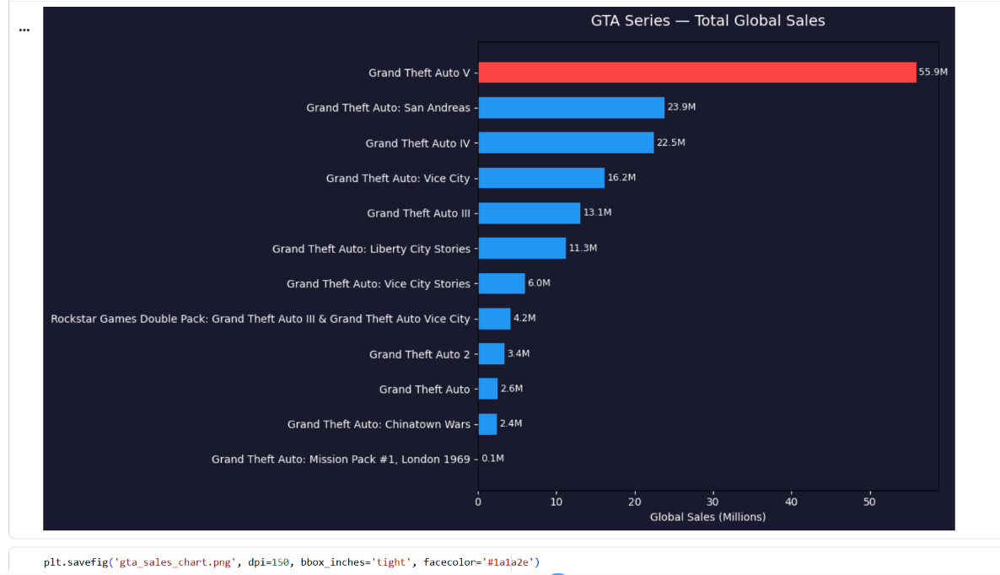
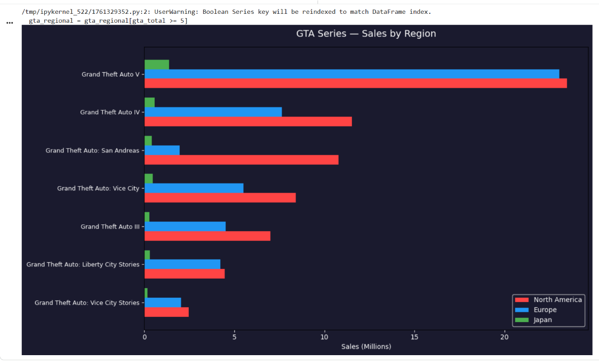
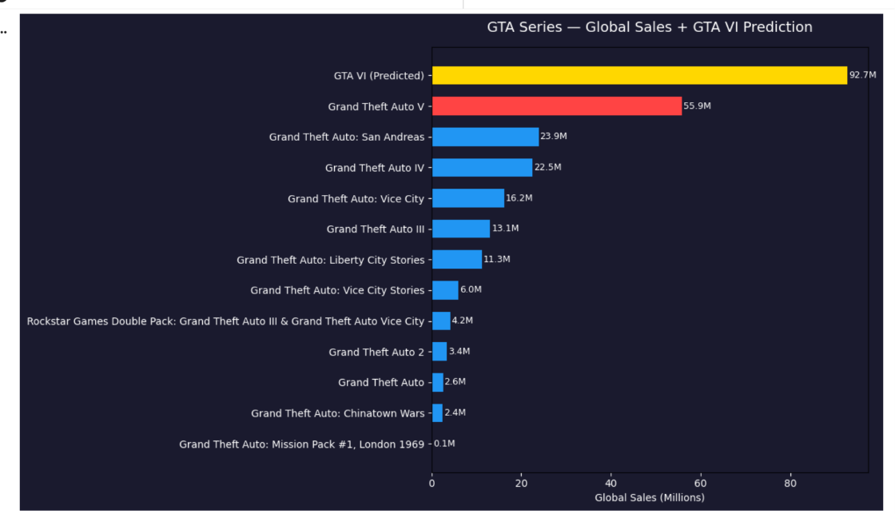

# gta-sales-analysis
GTA Series sales analysis + GTA VI prediction using Python and Linear Regression
# 🎮 GTA Series — Sales Analysis & GTA VI Prediction

## Overview
GTA VI just launched on 19 November 2026. I used Python to analyse 25 years of GTA sales data and built a Linear Regression model to predict how many copies GTA VI could sell.

## What I Found
- GTA V is the best-selling game in the series with **55.9M copies** (dataset covers up to ~2016)
- North America dominates every single GTA title — Europe is always second, Japan barely registers
- **GTA VI predicted sales: 92.7 million copies** based on historical franchise growth trend

## Charts
### Total Global Sales by Game

### Regional Breakdown — NA vs EU vs Japan

### GTA VI Prediction (Linear Regression)

## Tools Used
- Python
- Pandas
- Matplotlib
- Scikit-learn (Linear Regression)
- Google Colab

## Dataset
Video Games Sales dataset from Kaggle — 16,600 rows, 11 columns covering global game sales data.

## Author
Ayesha Irfan — Undergraduate Data & Reporting Analyst (Placement)
